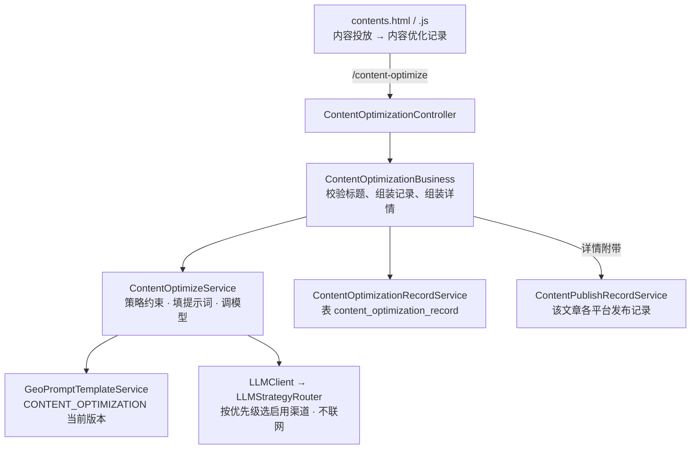

# 内容优化

用户提交标题和原文，系统按 GEO 论文策略取「提示词管理」里的正文优化提示词调用一次大模型，优化成功后把原文、优化稿、实际策略、发布前提示和引用一起存为一条内容优化记录，供列表、详情查看和后续预发布。

## 分层



## 一次优化保存怎么走

```mermaid
sequenceDiagram
    participant Page as 内容优化记录页
    participant Biz as Controller + ContentOptimizationBusiness
    participant Opt as ContentOptimizeService
    participant Prompt as GeoPromptTemplateService
    participant Llm as LLMClient
    participant Rec as ContentOptimizationRecordService
    Page->>Biz: POST /content-optimize/optimize（标题、原文、偏好，策略与参考资料传空）
    Biz->>Biz: 标题 1～200 字，偏好不超过 1000 字
    Biz->>Opt: optimizeContent
    Opt->>Opt: 正文非空；策略为空用默认（易于理解、流畅度）；拒绝关键词堆砌；事实类策略必须带参考资料
    Opt->>Prompt: getCurrentTemplate（未配置抛 NoSuchElementException，不调模型）
    Opt->>Opt: 填变量，正文和参考资料转义尖括号
    Opt->>Llm: query（单轮、不联网、本服务不重试）
    Llm-->>Opt: 优化正文 + 结构化引用
    Opt-->>Biz: 优化稿、实际策略、发布前提示、引用
    Biz->>Rec: insert（一次写入全部字段）
    Biz-->>Page: 已保存的记录
```

## 核心类

| 类 | 一句话 |
|---|---|
| `ContentOptimizationController` | 3 个接口：`POST optimize`、`GET list`、`GET detail/{id}`；日志只记长度和数量，不记正文 |
| `ContentOptimizationBusiness` | `optimizeAndSave`、`listContentOptimizationRecords`、`getContentOptimizationRecord`（详情带全部平台发布记录） |
| `ContentOptimizeService` | 解析策略、校验参考资料、取当前提示词填变量、调模型、生成发布前提示 |
| `ContentOptimizationStrategy` | 9 个论文策略：名称、执行要求、是否必须参考资料；关键词堆砌仅作对照，拒绝执行 |
| `PromptTemplateKey.CONTENT_OPTIMIZATION` | 「内容优化-正文优化提示词」，变量 `optimizationPreference`、`strategies`、`references`、`content` |
| `ContentOptimizationRecordService` | 保存与查询记录；列表不加载正文 |
| `ContentOptimizationRequest` / `ContentOptimizationResult` / `ContentOptimizationRecord` | 领域入参（策略、参考资料空值转空列表）/ 优化结果 / 记录（`domain/model/`） |
| 表 `content_optimization_record` | 标题、原文、优化稿、偏好；实际策略、提示、引用为 JSON |

源码：[优化服务](../../src/main/java/org/huangry/colorful/geo/domain/service/optimize/ContentOptimizeService.java)、[application/content](../../src/main/java/org/huangry/colorful/geo/application/content/)。

## 新业务接入改哪里

| 情况 | 要改的 | 不用改 |
|---|---|---|
| 新增优化策略 | `ContentOptimizationStrategy` 加枚举值（名称、执行要求、是否必须参考资料） | 服务、提示词（策略说明经 `{{strategies}}` 填入）、表 |
| 页面让用户选策略或填参考资料 | `contents.html/.js` 表单（目前固定传空列表，走默认策略） | 接口与服务已支持 |
| 改提示词文字 | 「基础配置 → 提示词管理」保存新版本，下次优化即生效 | 代码、发布 |
| 提示词加变量 | `PromptTemplateKey.CONTENT_OPTIMIZATION` 声明变量 + `ContentOptimizeService.buildOptimizationPrompt` 填值 + 初始模板脚本（见 [提示词管理约定](../../.claude/memory/modules/prompt-template.md)） | Business、表 |
| 换默认策略 / 固定模型渠道 | `ContentOptimizeService.DEFAULT_STRATEGIES` / `invokeContentOptimizationModel` 改传带渠道的 `LLMQueryRequest`（目前不指定渠道） | 其余各层 |

## 约束

- 优化成功才落库：模型失败或返回空正文不写半成品，原文、优化稿、策略、提示、引用一次写入。
- 不新增无据事实：统计信息补充、引用来源、引文增加三个策略必须带参考资料；没有参考资料时提示词明确禁止新增统计、来源和引文。
- 提示词只取「提示词管理」当前版本，未配置时报错（经全局处理返回 404），不调模型、不回退代码内置文字。
- 引用只透传模型通道返回的结构化引用，不从正文猜测。
- 优化记录不再修改：预发布时用户确认的标题和正文另存为发布记录快照（见 [多平台内容投放](多平台内容投放.md)）。

## 已知待改

- 列表 SQL 在 `ContentOptimizationRecordDao` 里联表 `content_publish_record` 统计发布状态，并直接返回应用层的 `ContentOptimizationRecordPageItem`（基础设施和领域层都反向依赖应用层模型），与“跨能力列表由 Business 分别取数组装”不符。
- `ContentOptimizeService` 直接调用领域 Service `GeoPromptTemplateService`；`ContentOptimizationRecordService` 继承 `ServiceImpl`。
- `ContentOptimizationException`（正文为空、关键词堆砌、缺参考资料、模型失败）没有异常映射，按代码推断接口返回 500 且无 `detail`，页面只能显示“请求失败（HTTP 500）”，未实测。
- 构造器注入：`ContentOptimizationBusiness`、`ContentOptimizationController`；接口输出 `ContentOptimizationRecordDetail` 未按 `XxxResponse` 命名。
- `TestController` 的 `/test/testOptimizeBusiness` 随生产部署，可绕过记录直接调付费模型，方法名也与 `TestOptimizeBusiness.testOptimize` 不同，去留待用户决定（见 [项目规范检查](../20261115_area_diagnosis/项目规范检查-2026-11-22.md)）。
