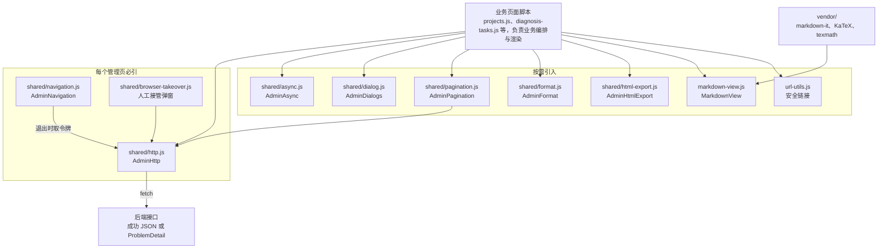
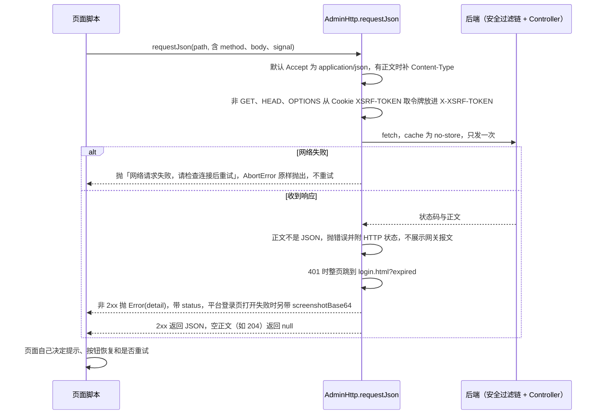

# 前端公共能力

管理页面没有框架和构建步骤，靠 `static/admin/shared/` 下的普通脚本共用请求、导航、人工接管、异步读取、弹窗等能力；每个脚本在 `window` 上挂一个冻结对象（如 `AdminHttp`），页面用 `<script>` 显式引入。

## 分层

## 一次页面接口请求怎么走

## 核心模块

| 模块（全局对象） | 一句话 |
|---|---|
| `shared/http.js`（`AdminHttp`） | `requestJson` 是唯一 JSON 请求入口：带令牌、401 跳登录、`ProblemDetail.detail` 转成错误；`csrfToken()` 供登录、退出等表单填 `_csrf` |
| `shared/navigation.js`（`AdminNavigation`） | 唯一菜单定义（4 组 13 页）：渲染侧栏、当前页高亮、面包屑和顶栏“退出”（表单 POST `../logout`） |
| `shared/browser-takeover.js` | 全局人工接管弹窗，见 [浏览器人工接管](浏览器人工接管.md) |
| `shared/async.js`（`AdminAsync`） | `createRequestScope` 让新读取取代旧读取、丢弃过期结果；`createPoller` 串行轮询，成功等 3 秒，网络、429、5xx 等 5 秒再读，其他错误停止 |
| `shared/dialog.js`（`AdminDialogs`） | 原生 `<dialog>` 的 ESC、点遮罩关闭和背景滚动锁，能否关闭与关闭后清理由业务传入 |
| `shared/pagination.js`（`AdminPagination`） | `listAll` 按 `size=100` 逐页读完 `PageResponse`，给下拉选项用；中途失败不返回部分结果 |
| `shared/format.js`（`AdminFormat`） | `dateTime` 按浏览器本地时区、中文 24 小时制显示，空值或非法值显示“—” |
| `shared/html-export.js`（`AdminHtmlExport`） | `downloadPage` 把一段页面内容连同内联样式存成可离线打开的 HTML 文件（诊断报告导出网页使用） |
| `markdown-view.js` + `markdown-view.css`（`MarkdownView`） | `render(container, value)` 只读展示正文：`html:false`，链接只放行 http、https、mailto，公式输出 MathML，解析失败退回纯文本 |
| `vendor/` | 本地固定版本 markdown-it 15.0.3、KaTeX 0.19.0、markdown-it-texmath 1.0.0 及许可文件，只给 `markdown-view.js` 用 |
| `url-utils.js` | 全局函数：`safeWebUrl`、`appendWebLink` 只放行 http、https 并隔离 opener，另含平台草稿入口 |
| `styles.css`、`styles/*.css` | 公共基础样式、组件、表单与诊断样式 |

Markdown 正文目前用于诊断任务、诊断报告、内容优化记录、发布记录四个页面。前端测试：`node --test src/test/js/*.test.cjs`，覆盖 http、async、dialog、pagination、navigation、展示函数和浏览器登录页；Markdown 另有 Playwright 脚本 `.test/markdown-view-check.js`。

源码：[shared 目录](../../src/main/resources/static/admin/shared/)、[markdown-view.js](../../src/main/resources/static/admin/markdown-view.js)、[前端测试](../../src/test/js/)。

## 新业务接入改哪里

| 情况 | 要改的 | 不用改 |
|---|---|---|
| 新增管理页面 | 页面骨架带 `aside[data-admin-navigation]`、`.breadcrumb`、`.topbar-label`；引入 `shared/http.js`、`shared/navigation.js`、`shared/browser-takeover.js`，`http.js` 要在页面脚本之前执行；在 `navigation.js` 的 `groups` 里加一项；接口请求一律用 `AdminHttp.requestJson` | 后端安全配置、其他页面 |
| 页面要展示 Markdown 正文 | 按顺序引入 `vendor/` 的 markdown-it、KaTeX、texmath，再引入 `markdown-view.js` 与 `markdown-view.css`，调用 `MarkdownView.render` | 解析器配置 |
| 新增公共组件 | 放 `shared/`，沿用现有写法：立即执行函数加 `"use strict"`，挂一个 `Object.freeze` 的 `window.AdminXxx`，只放通用能力、不含业务决策；补 `src/test/js/` 用例并更新其 `README.md` | 已有 shared 模块 |
| 修改已有公共脚本 | 检查所有引用页面的脚本顺序，同步更新各页的 `?v=` 资源版本 | — |

## 约束

- 业务请求不直接用 `fetch`，统一走 `AdminHttp.requestJson`；表单提交（登录、退出）用 `AdminHttp.csrfToken()` 填 `_csrf`。
- 新管理页必须引入 `shared/http.js`、`shared/navigation.js`、`shared/browser-takeover.js`，否则接口请求、导航退出或接管弹窗不可用。
- 公共层只管传输、展示和读取生命周期，不重试写请求、不记录报文；网络失败不代表服务端没执行。
- 模型回答、平台返回等外部文本只用 `textContent` 或 `MarkdownView` 展示；`innerHTML` 只出现在 `markdown-view.js`。
- 第三方库只用 `vendor/` 中的本地固定版本并附许可，浏览器不外连 CDN。

## 已知待改

- 前端 Node 测试 64 个中 11 个失败（`http.test.cjs` 2 个、`browser-login.test.cjs` 9 个）：测试替身没有 `document` / `document.cookie`，写请求调用 `csrfToken()` 时报错；2026-11-22 本地复跑结果相同。
- `diagnosis-reports.js`、`html-export.js`、`browser-takeover.js` 没有 Node 测试。
- `src/test/js/README.md` 仍写导航测试覆盖 11 页，实际菜单和用例都是 13 页。
