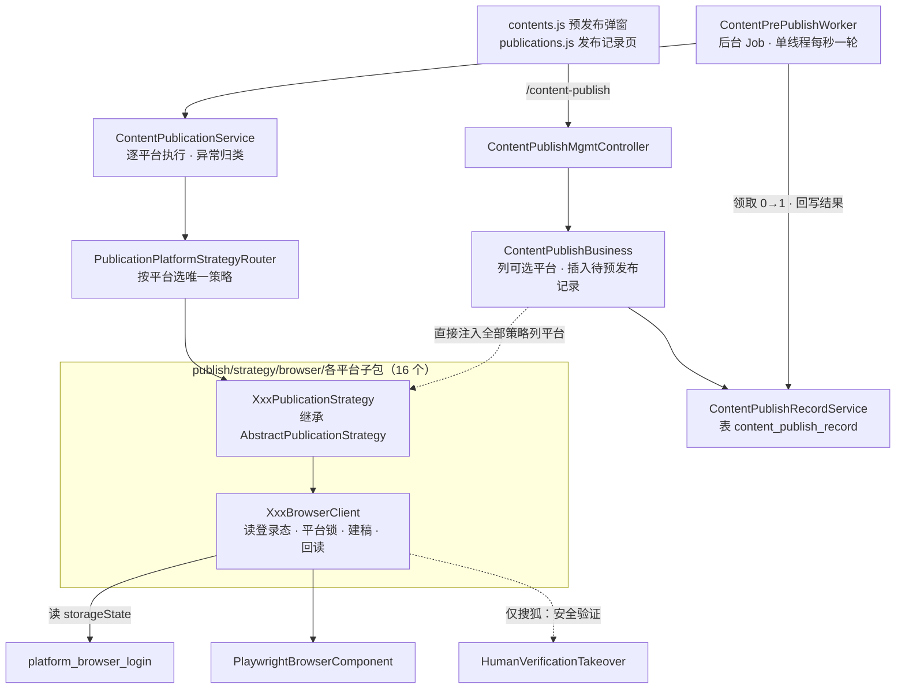
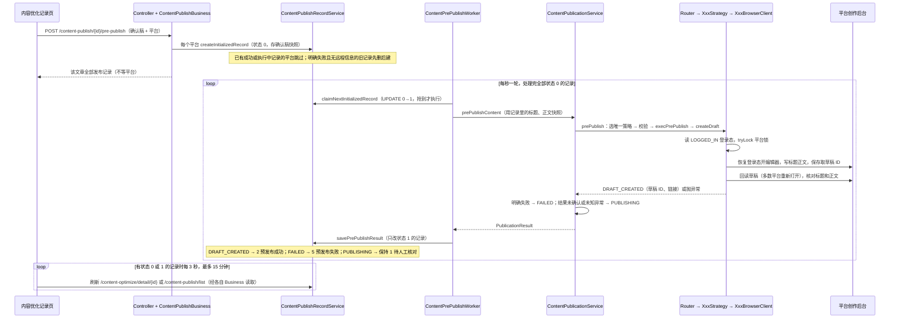

# 多平台内容投放

用户在内容优化记录上确认最终标题、正文并勾选平台后，系统为每个平台建一条发布记录；后台 Job 逐条领取，按平台路由到对应策略，由该平台的浏览器客户端用已保存的登录态在创作后台建草稿并回读确认，再把结果写回发布记录。公开发布目前只有知乎实现了平台动作，尚无调用入口。

## 分层

## 一次预发布怎么走

## 核心类

| 类 | 一句话 |
|---|---|
| `ContentPublishMgmtController` | `/content-publish`：`platforms`、`{id}/pre-publish`、`list`、`titles`、`DELETE detail/{id}`；删除执行中记录返回 409 |
| `ContentPublishBusiness` | 可选平台 = 有策略的平台（不看登录）；为每个平台插入待预发布记录后立即返回 |
| `ContentPublishRecordService` | 状态迁移：建记录、领取（0→1）、回写（只改 1）、删除非执行中（1、3 不可删） |
| `ContentPrePublishWorker` | 后台 Job：专用单线程池，逐条领取执行并回写；开关 `content.prepublish.worker.enabled`（默认开） |
| `ContentPublicationService` | 逐平台执行并归类异常；`publishDraft` 是公开发布入口（目前无调用方） |
| `PublicationPlatformStrategyRouter` | 按平台选策略，没有或多于一个都拒绝；回填结果的平台 |
| `PublicationPlatformStrategy` / `AbstractPublicationStrategy` | 策略接口 / 模板：先校验，再 `execPrePublish` 建稿或 `execPublish` 发布 |
| 各平台 `XxxPublicationStrategy` + `XxxBrowserClient` | 策略把客户端结果映射为 `PublicationResult`；客户端读登录态、加锁、建稿、回读 |
| `PublicationClientException` / `PublicationOutcomeUnknownException` | 明确失败（可重新预发布）/ 结果未确认（不可重试） |
| `ContentPublishRecordStatus` / `PublicationTaskStatus` | 记录状态，对应表 `publish_status` 0–7 / 策略返回的单平台状态 |
| `PublicationBrowserProperties` | 单个页面动作超时 `colorful.geo.publish.browser.timeout-millis`，默认 30000 毫秒 |

源码：[publish 包](../../src/main/java/org/huangry/colorful/geo/infrastructure/client/publish/)、[发布服务](../../src/main/java/org/huangry/colorful/geo/domain/service/publish/ContentPublicationService.java)、[Job](../../src/main/java/org/huangry/colorful/geo/presentation/task/ContentPrePublishWorker.java)。

| 平台 | 预发布 | 公开发布 |
|---|---|---|
| 知乎 | 建草稿并回读 | 已实现 `execPublish`，无调用入口 |
| 微信公众号、掘金、微博、CSDN、搜狐号、慕课网、东方财富、简书、什么值得买、一点资讯、抖音、哔哩哔哩、今日头条、百度百家号 | 建草稿并回读 | 未接入（抛“暂未接入”） |
| 小红书 | 不在平台建稿（网页草稿只存在浏览器本地），只确认系统已存确认稿 | 未接入 |
| 人人都是产品经理、51CTO、网易号 | 无策略（已能登录） | — |

## 新业务接入改哪里

| 情况 | 要改的 | 不用改 |
|---|---|---|
| 接一个新平台 | `strategy/browser/<平台>/` 新建 `@Component` 策略（继承 `AbstractPublicationStrategy`，`execPublish` 未接入就抛 `PublicationClientException`）和浏览器客户端（读登录态、平台锁、建稿、回读，开始写入后异常抛 `PublicationOutcomeUnknownException`）；平台须先能登录 | 路由（自动收集策略）、`ContentPublicationService`、Job、Business（可选平台自动出现）、接口、页面、表 |
| 为某平台接公开发布 | 该策略 `execPublish` + 客户端发布方法（参考知乎 `publishDraft`：点击后异常按未确认）；另需新做发布入口（接口/页面或 Job）和状态 3→4/6 的回写，目前都不存在；小红书还要让入参带确认稿（`PrePublicationRequest` 只有远程 ID），思路见其策略类注释 | 路由、`AbstractPublicationStrategy`、`ContentPublicationService.publishDraft` |
| 平台遇到验证码 | 客户端在可能遇到验证的步骤后调 `HumanVerificationTakeover.ensureHumanVerified`；新验证加到 `HumanVerificationRule`；需记住验证结果时写回登录态（参考搜狐）。详见 [浏览器人工接管](浏览器人工接管.md) | Job、策略、路由 |

## 约束

- 建稿必须回读确认：保存后回读草稿核对标题和正文（多数平台重新打开草稿，百家号、东方财富在当前页回读），一致才返回 `DRAFT_CREATED`，不一致按结果未确认；草稿 ID 只用平台明确返回的值，不伪造（取不到时多数平台按未确认，百家号、东方财富 ID 留空）。
- 写入后异常按结果未确认、不自动重试：未确认异常、未知异常、结果回写失败，记录都停在“预发布中”等人工核对平台草稿箱；只有“预发布失败”且没有远程 ID、草稿链接、公开链接的记录才能重新提交。
- 平台串行：Job 单线程逐条执行；每个平台客户端一把锁，忙时 `tryLock` 失败按明确失败返回；知乎建稿与发布共用一把锁；锁只在单个服务实例内有效。
- 登录态只从 `platform_browser_login` 读，且状态须为 `LOGGED_IN`、内容为 JSON；投放请求模型不携带登录态（见 [平台浏览器登录](平台浏览器登录.md)）。
- 用确认稿快照：Job 只用发布记录里的标题、正文，不读优化记录当前内容；同一文章同一平台只有一条记录（唯一键）。

## 已知待改

- 公开发布没有入口：`ContentPublicationService.publishDraft` 无调用方，“实际发布中/成功/失败”（3/4/6）目前没有代码写入。
- 停在“预发布中”的记录没有页面或接口可改状态或删除，人工核对后的处理方式待确认。
- 16 个客户端各自注入 `PlatformBrowserLoginDao`、重复判断登录态可用（读取方案 A/B 待定）；15 个客户端各有一份相同的内部 record `DraftCreated`（微信公众号直接返回 ID）。见 [TODO](../TODO.md)「平台登录与内容投放的分层整改」。
- 客户端模型被上层直接使用：`PublicationResult` 进入 Job 和领域服务，`PublicationPlatformOption` 作接口返回，Job 直接构造 `PublicationRequest`；`ContentPublishBusiness.listConfiguredPlatforms` 直接注入全部策略；可选平台不看登录状态；平台身份用投放平台枚举 `PublicationPlatformType`。
- `ContentPrePublishWorker` 在展示层直接调两个领域 Service 并使用实体 `ContentPublishRecordEntity`，应经应用层；`ContentPublishRecordService` 继承 `ServiceImpl`。
- 构造器注入：10 个客户端、9 个策略、`PublicationPlatformStrategyRouter`、`ContentPublicationService`。
- `XiaohongshuBrowserClient` 无调用方（按原决定保留）；`TestController` 的 `/test/prePublish/{platformType}`、`/test/prePublishBatch` 绕过发布记录直接建稿，去留待用户决定。
