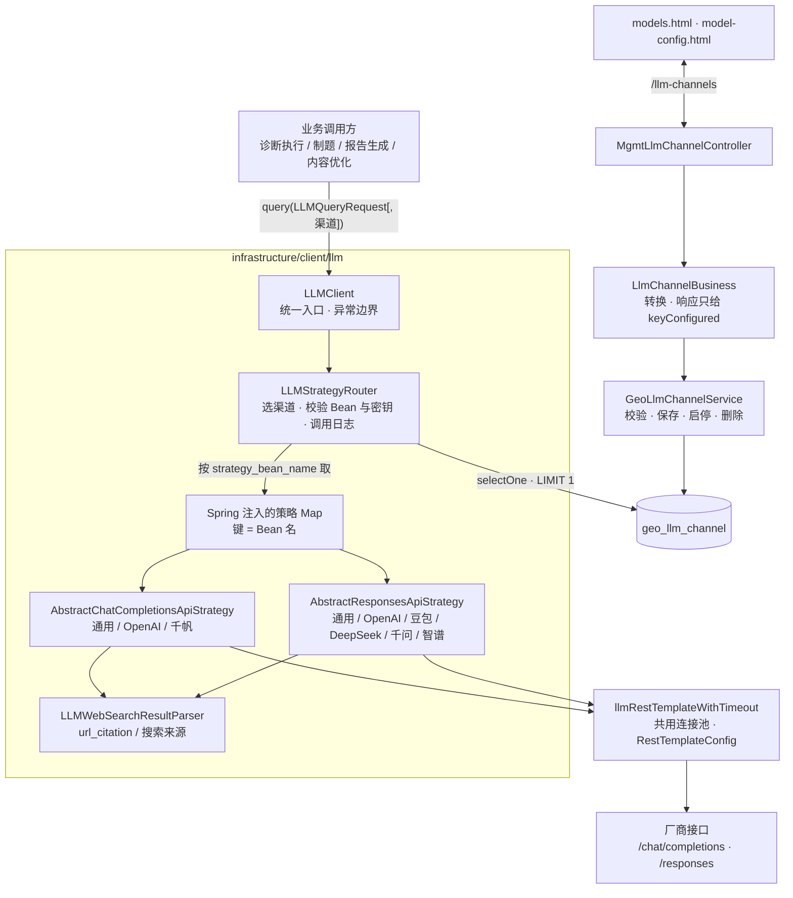
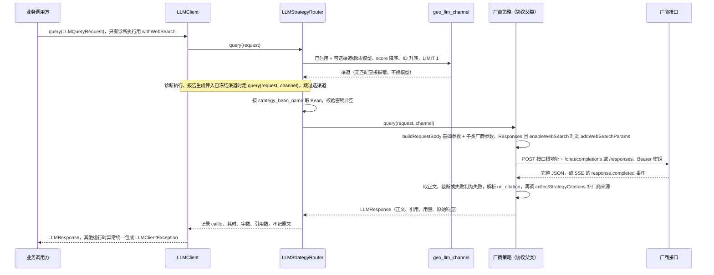

# 大模型渠道与调用

业务用一个入口 `LLMClient` 发起单次独立问答：从库表 `geo_llm_channel` 选出渠道，按渠道保存的策略 Bean 名找到厂商策略，由协议父类发请求、解析正文和引用。

## 分层

## 一次模型调用怎么走

## 核心类

| 类 | 一句话 |
|---|---|
| `LLMClient` | 业务唯一要调的入口：`query(String)`、`query(LLMQueryRequest)`、`query(request, channel)` |
| `LLMStrategyRouter` | 查库选一条渠道、按 Bean 名取策略、校验密钥、记调用日志；`selectDefaultChannel` 供报告冻结判定渠道 |
| `LLMStrategy` | 策略契约：`protocolType`、`displayName`、`apiKeyConsoleUrl`（默认 null）、`query` |
| `AbstractChatCompletionsApiStrategy` / `AbstractResponsesApiStrategy` | 协议父类：校验地址与模型、组请求、发 HTTP、解析正文与 url_citation；Responses 父类另管 SSE 读取和联网开关 |
| `LLMQueryRequest` / `LLMResponse` / `LLMCitation` | 请求只有 `prompt`、`channelCode`、`modelName`、`enableWebSearch`；结果为正文、引用、元数据；一条引用 |
| `LLMWebSearchResultParser` / `LLMJsonOutputParser` | 解析 url_citation 与 `web_search_call.action.sources`；从模型正文截出 JSON，供业务解析 |
| `RestTemplateConfig` | 注册 `llmHttpClient`（总连接 100、单目标 20、闲置 30 秒回收，不重试、不跟随重定向、不存 Cookie）和 `llmRestTemplateWithTimeout`；超时与证书校验取 `http.llm.timeout-seconds`、`http.llm.ssl-verify` |
| `GeoLlmChannelService` | 渠道校验与保存（编码不可改、空密钥保留原值）、启停（Bean 未注册或无密钥拒绝启用）、删除（被诊断方案引用时拒绝） |
| `MgmtLlmChannelController` / `LlmChannelBusiness` | `/llm-channels` 7 个接口：策略选项、新建、编辑、详情、列表、启停、删除 |

9 个具体策略（Bean 名 = 类名首字母小写），Responses 策略的联网参数只在开关打开时挂载：

| Bean | 联网 | 引用（父类都解析 url_citation） |
|---|---|---|
| `chatCompletionsApiCommonStrategy` / `responsesApiCommonStrategy` | 不联网 | — |
| `chatCompletionsApiOpenAiStrategy` | 只有模型 `gpt-5-search-api` 固定加 `web_search_options`，不看开关 | — |
| `chatCompletionsApiQianfanStrategy` | 千帆智能搜索接口本身就搜，不看开关 | 另补顶层 `references` 中 `type=web` 的网址和标题 |
| `responsesApiOpenAiStrategy` | `web_search` + `tool_choice=required` | — |
| `responsesApiDoubaoStrategy` | `web_search`（`sources: doubao`）+ `required` | — |
| `responsesApiDeepSeekStrategy` | `web_search` + `required` | 另补 `web_search_call` 的 `open_page` 网址（去掉 `ws_call_id`） |
| `responsesApiQwenStrategy` | `web_search` + `required` | 另补 `web_search_call.action.sources` |
| `responsesApiZhipuStrategy` | 只挂 `web_search`，不发 `tool_choice` | 另补 `web_search_call.action.sources` |

豆包、DeepSeek、千问、智谱固定 `stream=true`，只取完成事件里的完整回答。源码：[llm 包](../../src/main/java/org/huangry/colorful/geo/infrastructure/client/llm/)，设计决策见 [大模型调用记忆](../../.claude/memory/modules/llm.md)。

## 新业务接入改哪里

| 情况 | 要改的 | 不用改 |
|---|---|---|
| 接一个新厂商策略 | `strategy/` 下新建类继承对应协议父类并加 `@Component`；实现 `displayName()`，按需重写 `apiKeyConsoleUrl`、`buildRequestBody`、`addWebSearchParams`、`collectStrategyCitations`；在模型配置页新建渠道选这个 Bean | 路由、`LLMClient`、接口、库表、页面策略下拉（`/llm-channels/strategies` 按实际 Bean 列出） |
| 新业务要调用模型 | 注入 `LLMClient`，`query(new LLMQueryRequest(prompt[, channelCode, modelName]))`；多次调用要固定同一渠道时参考报告判定，选定渠道后用 `query(request, channel)`；提示词放 [提示词管理](提示词管理.md) | 策略、路由、渠道配置 |
| 要不要联网 | 默认不联网，什么都不写；只有确要测联网回答才用 `LLMQueryRequest.withWebSearch`，并选能开关搜索的 Responses 厂商策略 | 策略不判断用途；Chat Completions 父类目前不读开关，要用需先给它加开关 |
| 新协议 | `LLMProtocolType` 加枚举值；新建抽象父类实现 `LLMStrategy`，注入 `llmRestTemplateWithTimeout`，负责组请求和解析正文、引用；厂商策略继承它 | 路由、库表（协议不入库，从 Bean 推导）、页面协议名称（取枚举描述） |

## 约束

- 库表 `geo_llm_channel` 是唯一配置来源，不读 YAML、不回退；无匹配渠道或调用失败直接报错，不自动切换模型或渠道。
- 渠道只存 `strategy_bean_name`，Bean 未注册时保存、启用、调用都拒绝，不反射、不降级；重命名 Bean 要同步迁移库里的值。
- 联网由调用方声明：`enableWebSearch` 默认 false，只有诊断执行（`DiagnosisTaskWorker`）和测试接口打开；千帆智能搜索和 `gpt-5-search-api` 不受开关控制，内部任务不要选。
- 引用只取响应里的结构化字段（url_citation 或子策略声明的来源），不从正文网址或检索词猜。
- 密钥只在服务端：只放请求头，接口响应只给 `keyConfigured`，实体与请求的 `apiKey` 不进 `toString`，日志只记长度、引用数和元数据。

## 已知待改

- `LLMStrategyRouter` 在客户端层注入 `GeoLlmChannelDao` 查库；`LLMStrategy.query` 直接接收数据库实体 `GeoLlmChannelEntity`。按 11-22 模型归属规范应在边界转成 `client/llm/model/` 下的调用模型，尚未迁移。
- `LLMStrategyRouterTest.shouldRejectDisabledExactTaskChannel` 既有失败：`query(request, channel)` 不检查 `enabled`，与诊断模块“冻结渠道只有被删除才失败”的记录冲突，待用户定规则。
- `geo_llm_channel.timeout_seconds`、`ssl_verify` 仍校验并保存，但请求只认 `http.llm.*`，两列不生效（页面已不展示）。
- `GeoLlmChannelService` 继承 `ServiceImpl` 直接用 DAO，删除时直接读诊断模块的 `GeoDiagnosisPlanChannelDao`。
- `TestController` 的 `POST /test/llmQuery` 直接注入 `LLMClient` 联网调用付费模型，去留待用户决定。
- 小问题：`models.js` 硬编码 `chatCompletionsApiOpenAiStrategy` + `gpt-5-search-api` 时禁用生成参数，与后端重复；Responses 父类只去掉一个末尾斜杠，Chat 父类去掉全部。
