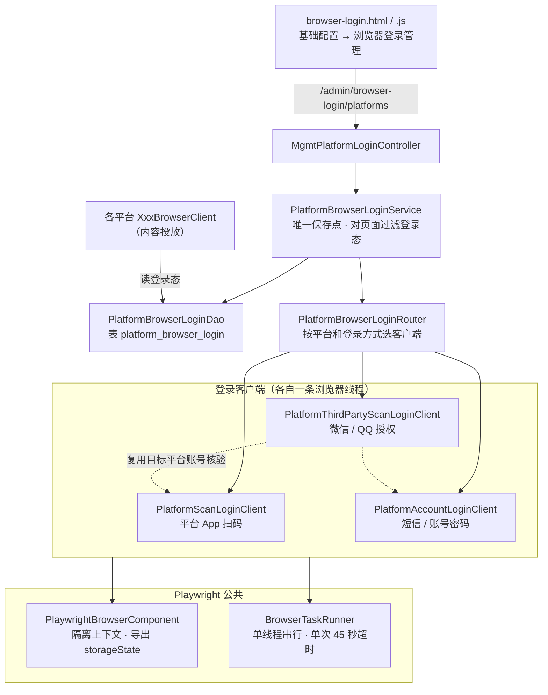
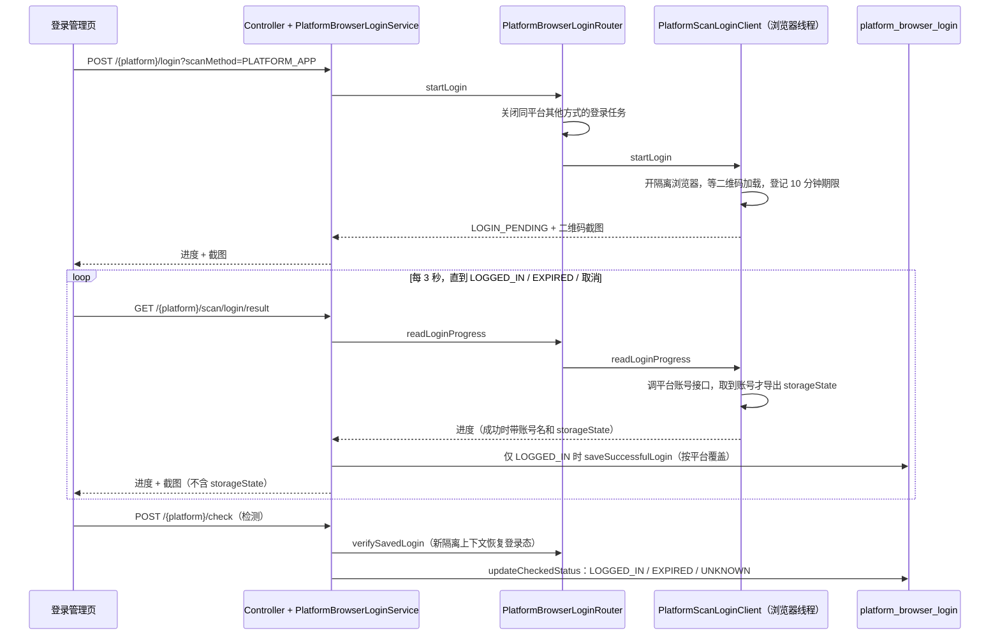

# 平台浏览器登录

在服务器的隔离浏览器里打开各内容平台的登录页，用户在管理页扫码、填短信或账号密码、走微信/QQ 授权；平台账号接口确认身份后，把 Playwright `storageState` 保存为该平台的登录态，供内容投放等业务恢复使用，并可随时重新核验。

## 分层

## 一次扫码登录怎么走

## 核心类

| 类 | 一句话 |
|---|---|
| `MgmtPlatformLoginController` | 11 个接口：状态列表、打开登录、短信发码/提交、密码、抖音二次验证、进度、取消、单个检测、批量检测已登录平台 |
| `PlatformBrowserLoginService` | 进度为 `LOGGED_IN` 才落库；检测后更新状态；对页面只给状态、账号名、截图 |
| `PlatformBrowserLoginRouter` | 按平台和扫码方式选客户端，切换方式时关闭同平台旧任务；推导页面可用的登录方式 |
| `PlatformScanLoginClient` | 平台 App 扫码（`LOGIN_SITES` 13 个平台），含 CSDN/什么值得买原站微信码、抖音二次验证 |
| `PlatformAccountLoginClient` | 短信、账号密码表单（`LOGIN_SITES` 7 个平台），含百家号 App 扫码 |
| `PlatformThirdPartyScanLoginClient` | 微信/QQ 授权（`LOGIN_ENTRIES` 入口表），成功与否仍由目标平台账号接口判定 |
| `PlaywrightBrowserComponent` / `BrowserTaskRunner` | 开隔离 Chromium（中文、北京时间、不走代理）/ 每个客户端一条串行浏览器线程 |
| `PlatformBrowserLoginDao` + 表 `platform_browser_login` | 每平台一行：账号名、`login_status`、`storage_state`、最近登录与核验时间 |
| `PlatformBrowserLoginStatus` / `PlatformBrowserLoginTaskStatus` | 账号登录态（列表与表）/ 一次登录任务的进度（不落库） |

当前 19 个平台枚举都已接入至少一种方式，各平台开放哪些方式只看三个客户端的平台表。源码：[login 包](../../src/main/java/org/huangry/colorful/geo/infrastructure/client/login/)、[登录服务](../../src/main/java/org/huangry/colorful/geo/domain/service/login/PlatformBrowserLoginService.java)。

## 新业务接入改哪里

| 情况 | 要改的 | 不用改 |
|---|---|---|
| 平台加 App 扫码 | `PlatformScanLoginClient.LOGIN_SITES` 加站点（登录页、二维码选择器、账号接口）+ 账号响应解析分支 | Router、Service、接口、页面（按钮由 Router 推导）、表 |
| 平台加短信 / 密码 | `PlatformAccountLoginClient.LOGIN_SITES` 加 `FormLoginSite`（短信、密码开关）+ 表单步骤与账号解析分支 | 同上 |
| 已有平台加微信 / QQ 授权 | `PlatformThirdPartyScanLoginClient.LOGIN_ENTRIES` 加授权按钮选择器 | 账号核验（复用该平台扫码或表单核验）、页面 |
| 微信码就在平台原站登录页 | 除扫码站点外，`handlesScanMethod` 与 Router 的 `startLogin`、`scanMethods` 加分支（参考 CSDN、什么值得买） | 第三方授权客户端 |
| 登录页出现滑块等必须人操作的验证 | 待确认：登录客户端目前未调用 [浏览器人工接管](浏览器人工接管.md)，且登录动作有 45 秒超时，接管会阻塞线程最长 600 秒 | — |
| 非投放平台（京东、Reddit 等） | 先从 `PublicationPlatformType` 拆出通用平台枚举（见 [TODO](../TODO.md)） | — |

## 约束

- 每平台一个账号：`platform_type` 唯一，新登录按平台覆盖旧登录态；多账号等需求出现再建表（见 TODO）。
- 登录成功以平台账号接口（抖音为创作者主页）给出账号为准，页面跳转或 Cookie 存在不算；检测时只有明确未登录才记 `EXPIRED`，网络或风控记 `UNKNOWN`。
- 登录态只在服务端读取：接口只返回状态、账号名和截图；`storage_state` 明文入库，不进日志和响应；手机号、密码、短信码只送入当前登录页，不落库。
- 每类登录客户端同一时间只保留一个登录任务，10 分钟过期；任务只在发起实例的内存里。
- 投放只认 `LOGGED_IN`：检测得到 `UNKNOWN` 或 `EXPIRED` 后预发布直接失败，批量检测也只覆盖 `LOGGED_IN` 的平台，需单独检测或重新登录。

## 已知待改

- 平台身份用的是投放平台枚举 `PublicationPlatformType`。
- `PlatformBrowserLoginService` 直接注入 `PlatformBrowserLoginDao`；`MgmtPlatformLoginController` 直调领域 Service，没有 Business。
- 发布侧 16 个客户端各自读登录表、重复判断登录态可用，读取方案 A/B 待定（见 [多平台内容投放](多平台内容投放.md)、TODO「平台登录与内容投放的分层整改」）。
- 出参写成内部 record：`BrowserLoginSnapshot` 3 份、`AccountProbe` 4 份、Router 的 `LoginSnapshot`、服务里的 `PlatformLoginView`/`LoginProgress`、Controller 的 3 个请求 record。
- 构造器注入：`PlatformBrowserLoginService`、`PlatformBrowserLoginRouter`、`PlatformThirdPartyScanLoginClient`、`MgmtPlatformLoginController`；枚举 `PublicationLoginStatus` 已无引用。
