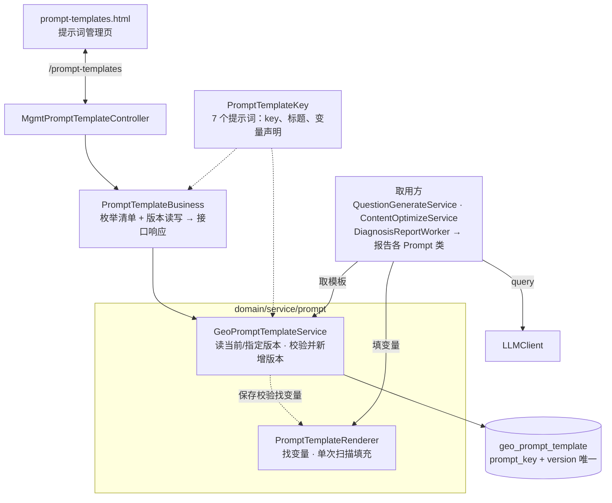
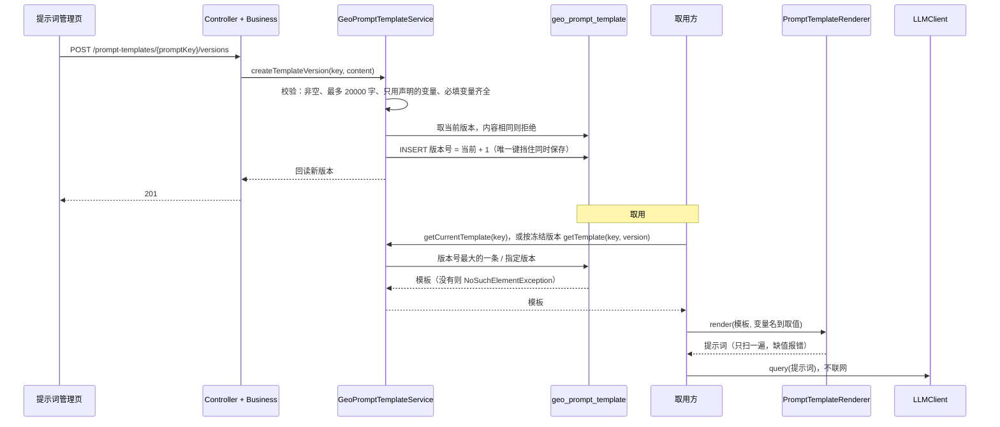

# 提示词管理

发给模型的提示词以模板形式存在库表 `geo_prompt_template`，在「基础配置 → 提示词管理」页编辑；每次保存新增一版，业务调用时取当前版本或冻结的版本，按变量名填入数据。

## 分层

## 一次保存与取用怎么走

各业务取哪一版：

- 制题两个（`QuestionGenerateService` 生成母题、按地域改写）、内容优化（`ContentOptimizeService`）：每次调用读当前版本，在本类填变量；缺提示词时不调模型。
- 报告逐条判定：`DiagnosisReportWorker` 首次取当前版本，把 `v` + 版本号冻结到 `geo_diagnosis_report.prompt_version`，续跑按该版本读；手动重判清空冻结值，改用最新版。判定提示词初始即第 2 版（沿用 v2 编号）。
- 报告第 2 段三个（合并同义维度、优化建议、地域策略）：每次执行开始读一次当前版本，传给各 `*Prompt` 类，同一次执行不重复查库。

## 核心类

| 类 | 一句话 |
|---|---|
| `PromptTemplateKey` | 声明可维护的提示词：枚举名即 `prompt_key`，带标题和变量（英文名、中文说明、是否必填）；声明顺序即页面下拉顺序 |
| `GeoPromptTemplateService` | `getCurrentTemplate`（缺则抛错）、`findCurrentTemplate`（页面用，允许为空）、`getTemplate(key, version)`、`listTemplateVersions`、`createTemplateVersion` |
| `PromptTemplateRenderer` | `render` 一次扫描填 `{{变量名}}`，缺值抛 `IllegalStateException`；`listVariableNames` 供保存校验 |
| `MgmtPromptTemplateController` / `PromptTemplateBusiness` | `/prompt-templates` 5 个接口：列表、当前版本、版本列表、指定版本、保存新版本 |
| `ResultJudgePrompt` / `DimensionPrompt` / `AdvicePrompt` / `RegionStrategyPrompt` | 报告用：模板 + 数据 → 提示词，以及解析模型输出；不访问数据库 |
| `prompt-templates.js` | 页面：选提示词、看可用变量、载入旧版本、保存新版本 |

源码：[prompt 领域服务](../../src/main/java/org/huangry/colorful/geo/domain/service/prompt/)、[PromptTemplateKey](../../src/main/java/org/huangry/colorful/geo/infrastructure/common/enums/PromptTemplateKey.java)；初始模板在 [001_init.sql](../../src/main/resources/db/mysql/001_init.sql)，已有库迁移参考 [提示词管理-服务器执行](../20261115_area_diagnosis/提示词管理-服务器执行.md)；设计决策见 [提示词管理记忆](../../.claude/memory/modules/prompt-template.md)。

## 新业务接入改哪里

| 情况 | 要改的 | 不用改 |
|---|---|---|
| 新增一个提示词 | `PromptTemplateKey` 按业务流程位置加枚举值并声明变量 → `001_init.sql` 写初始模板（不存在才插入），`.doc/<分支>/` 给已有库写迁移脚本 → 取用处改为取模板 + `render`；`GeoPromptTemplateServiceTest.shouldSeedEveryPromptWithValidTemplate` 会检查每个枚举都有合规的初始模板 | 表结构、接口、Service、页面（清单和变量说明来自枚举） |
| 改模板变量 | 改枚举里的变量声明和取用处的取值；库里当前版本仍写旧变量名会在渲染时报错，需同时保存一版新模板（或写迁移），并同步 `001_init.sql`；判定提示词已冻结旧版本的报告续跑仍按旧模板渲染 | 表结构、接口、页面 |
| 新业务取用 | 由 Business 或应用执行器取 `getCurrentTemplate(key)` 后传给业务类填变量（报告 `*Prompt` 的做法），再调 `LLMClient`；整段执行要口径一致时像判定那样冻结版本号 | 表、接口、页面、`GeoPromptTemplateService` |

## 约束

- 库是唯一来源：代码不留默认文字，缺了抛 `NoSuchElementException`（“提示词未配置：…”），不回退；制题、内容优化经全局处理返回 404，报告暂停并写明缺哪个。
- 保存总是新增一版，不覆盖、不删除；与当前版本相同拒绝保存。回滚 = 载入旧版本再保存成新版本。
- 模板只能用枚举声明的变量，必填变量必须出现；渲染只扫一遍，填进去的回答原文不会被再次替换，取不到值直接报错，不把占位符发给模型。
- 模板里约定的输出格式与解析代码绑定：改模板要保持格式，改坏了制题直接报错、报告在那一步暂停。

## 已知待改

- `GeoPromptTemplateService` 直接调用 `GeoPromptTemplateDao`，读写都返回数据库实体 `GeoPromptTemplateEntity`，`PromptTemplateBusiness`、`DiagnosisReportWorker` 也直接用实体；与 11-22 分层和模型归属规范不符，尚未迁移。
- 领域 Service 互调：`QuestionGenerateService`、`ContentOptimizeService` 直接注入 `GeoPromptTemplateService`，按规范应由 Business 取模板后传入。
- `DiagnosisReportWorker`（`presentation/task`）自己取模板、冻结判定版本，模板组合用内部 record `ContentPromptTemplates`；按规范 Worker 只管领取与调度，应改走应用执行器。
