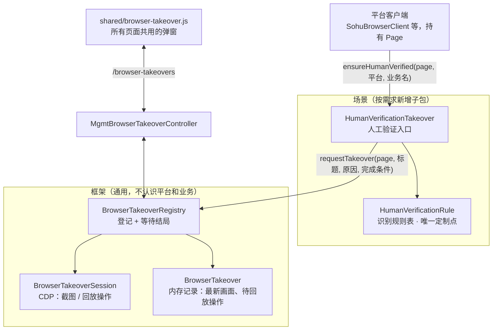
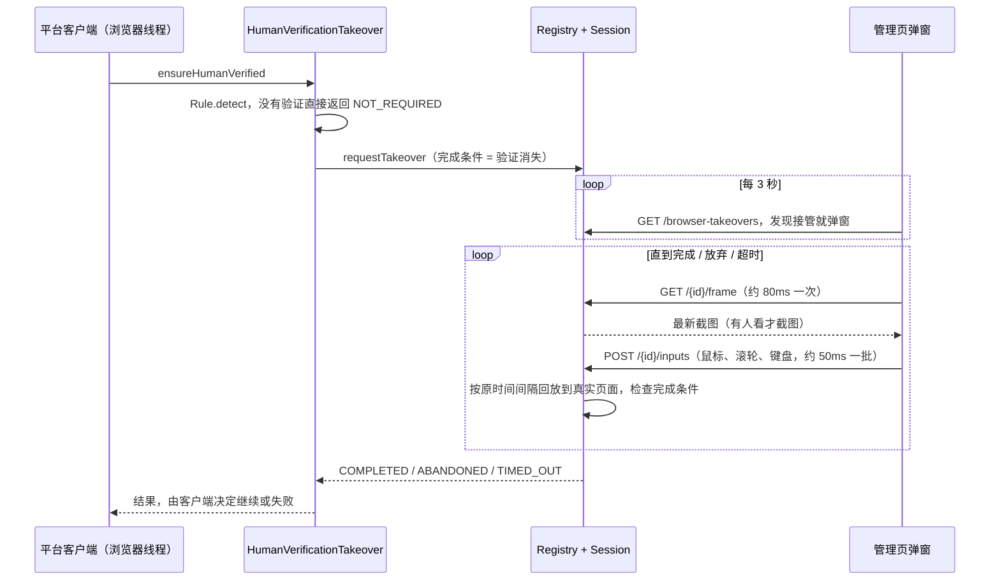

# 浏览器人工接管

服务器上的无头浏览器遇到必须由人完成的操作（滑块、短信安全验证等）时，把页面实时画面推到管理页弹窗，用户在弹窗里操作，操作转发回服务器页面，直到完成条件满足。

## 分层

## 一次接管怎么走

## 核心类

| 类 | 一句话 |
|---|---|
| `HumanVerificationTakeover` | 业务唯一要调的入口：有验证才请求接管 |
| `HumanVerificationRule` | 每种验证怎么认出来（地址或页面元素），新验证只加这里 |
| `BrowserTakeoverRegistry` | 登记接管；调用线程在这里一边转发画面和操作，一边等结局 |
| `BrowserTakeoverSession` | CDP 通道：`Page.startScreencast` 取画面，`Input.dispatch*` 回放操作 |
| `BrowserTakeover` / `BrowserTakeoverInput` / `BrowserTakeoverFrame` | 内存记录、一次用户操作、一帧画面 |
| `MgmtBrowserTakeoverController` | 弹窗用的 4 个接口：列表、画面、提交操作、放弃 |
| `shared/browser-takeover.js` | 弹窗：轮询发现接管、显示画面、采集并分批发送操作 |

源码：[takeover 包](../../src/main/java/org/huangry/colorful/geo/infrastructure/client/playwright/takeover/)，接入步骤详见两个场景类的类注释。

## 新业务接入改哪里

| 情况 | 要改的 | 不用改 |
|---|---|---|
| 新业务遇到已有验证 | 平台客户端在可能遇到验证的步骤后调 `ensureHumanVerified`，业务名填新业务，按返回值继续或失败 | 规则、框架、接口、前端 |
| 遇到新的验证 | `HumanVerificationRule` 加一个枚举值 | 已接入的调用处自动生效 |
| 验证通过后要记住 | 客户端导出会话写回登录态（参考搜狐） | — |
| 不是验证的新场景（如人工选择） | `takeover/` 下新建场景子包：决定何时请求、完成条件，调 `requestTakeover` | 框架、接口、前端 |
| 非投放平台（京东、Reddit 等） | 先把规则里的投放平台枚举换成通用平台枚举（见 TODO） | — |

## 约束

- 必须在创建 Page 的浏览器线程调用；等待期间该线程阻塞，超时 `colorful.geo.browser-takeover.timeout-seconds`（默认 600 秒）。
- 记录只在内存，服务重启即消失。
- 只做实时转发：不识别验证码、不自动操作、不录制留存，验证由用户本人完成。
- 新管理页必须引入 `shared/browser-takeover.js`，否则看不到弹窗。

## 已知待改

- 规则表的平台用的是投放平台枚举 `PublicationPlatformType`。
- `MgmtBrowserTakeoverController` 直接调登记表，按分层规范应经 Business。
- `SohuBrowserClient` 有两处自己判断规则，与入口内的识别重复。
