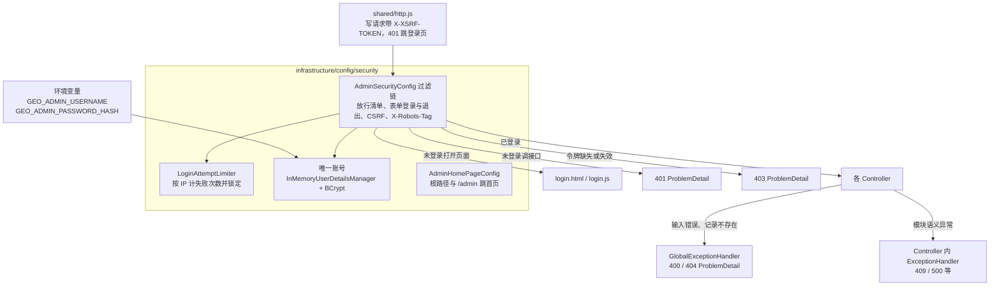
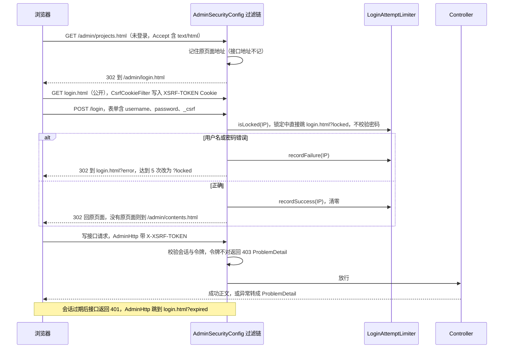

# 管理后台登录与访问控制

管理后台只有一个由环境变量配置的管理员账号，除登录页等少量资源外，所有页面和接口都要先登录；写请求必须带跨站令牌，接口出错统一返回 `ProblemDetail`。

## 分层

## 一次从未登录到调用写接口怎么走

## 核心类

| 类 / 资源 | 一句话 |
|---|---|
| `AdminSecurityConfig` | 唯一定制点：放行清单、表单登录 `POST /login`、退出 `POST /logout`、未登录处理、CSRF、`X-Robots-Tag: noindex, nofollow`；密码哈希为空或不以 `$2` 开头（非 BCrypt）时拒绝启动 |
| `LoginAttemptLimiter` | 按客户端 IP 计失败：相邻两次失败间隔不超过 15 分钟，累计 5 次即锁定，锁到最后一次失败后 15 分钟；登录成功清零；只存本进程内存 |
| `AdminHomePageConfig` | `/`、`/admin`、`/admin/` 重定向到首页 `/admin/contents.html`，避免登录后回跳到 404 |
| `GlobalExceptionHandler` | `IllegalArgumentException → 400`、`NoSuchElementException → 404`，记 warn 日志，返回 `ProblemDetail` |
| `static/admin/login.html`、`login.js` | 登录表单；按 `?locked`、`?error`、`?expired`、`?logout` 显示提示，提交前用 `AdminHttp.csrfToken()` 填 `_csrf` |
| `static/robots.txt` | `Disallow: /`，禁止所有爬虫抓取；登录页另有 `noindex` meta |

配置：`application.yml` 的 `admin.login.username`、`admin.login.password-hash` 分别读环境变量 `GEO_ADMIN_USERNAME`、`GEO_ADMIN_PASSWORD_HASH`；会话 Cookie `same-site: lax`；`server.forward-headers-strategy: native` 让锁定按 Nginx 转发的真实 IP 计数。前端怎么带令牌、怎么跳登录页见 [前端公共能力](前端公共能力.md)。

源码：[security 包](../../src/main/java/org/huangry/colorful/geo/infrastructure/config/security/)、[GlobalExceptionHandler](../../src/main/java/org/huangry/colorful/geo/presentation/controller/GlobalExceptionHandler.java)。

## 新业务接入改哪里

| 情况 | 要改的 | 不用改 |
|---|---|---|
| 新增公开资源（不登录也能访问） | 只改 `AdminSecurityConfig` 的放行清单；公开页面用到的样式、脚本要逐个加入 | 其他页面、Controller、前端请求层 |
| 新增需要登录的页面或接口 | 不用配置，默认 `anyRequest().authenticated()`；写请求经 `AdminHttp.requestJson` 自动带令牌 | 安全配置 |
| 新接口遇到输入错误或记录不存在 | 抛 `IllegalArgumentException` / `NoSuchElementException`，消息写成用户能看懂的原因 | `GlobalExceptionHandler`；Controller 不重复处理 |
| 新接口有模块语义的异常（状态冲突、存储失败等） | 在该 Controller 写 `@ExceptionHandler` 返回 `ProblemDetail`（如 409、500），不回显 SQL 或正文；`standaloneSetup` 单测加 `.setControllerAdvice(new GlobalExceptionHandler())` | 全局处理器；不新建业务错误码信封或 `BizException` |

## 约束

- 只有一个账号，不建用户表、不提供注册；配置只放 BCrypt 哈希。
- 公开范围只有 `/admin/login.html`、`/admin/login.js`、`/admin/login.css`、`/admin/styles.css`、`/admin/shared/http.js`、`/robots.txt`、`/error`，新增公开资源只改 `AdminSecurityConfig`。
- 未登录时，`Accept` 含 `text/html` 的请求跳登录页并记住原页面，其余请求返回 401 `ProblemDetail`；令牌缺失或失效返回 403 `ProblemDetail`（“页面已过期，请刷新页面后重试”）。
- 接口出错一律返回 `ProblemDetail`，前端读 `detail`；不返回 `{"message": ...}` 等自定义结构。
- 失败计数只在本进程内存，重启清空、不跨实例共享；`X-Robots-Tag` 和 `robots.txt` 只约束遵守规则的爬虫，真正的访问控制靠登录。
