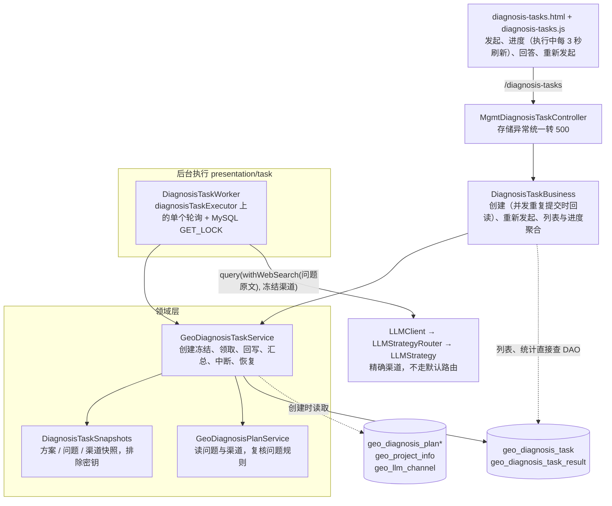
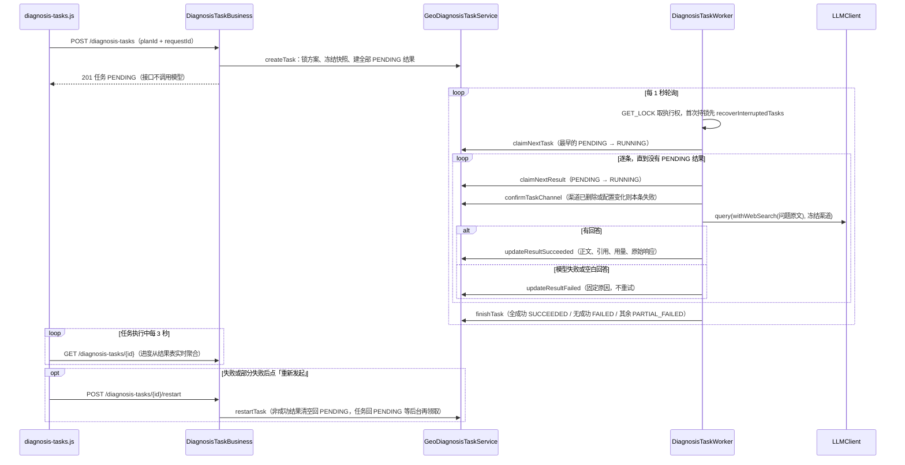

# 诊断任务

把一份 [诊断方案](诊断方案.md) 执行一轮。创建时冻结方案配置，后台按「问题 × 被测渠道 × 重复执行次数」逐条联网调用模型，保存回答、引用和用量，供查看进度和生成诊断报告。入口在「资产诊断 → 诊断任务」，关闭页面不影响后台执行。

## 分层

## 一次诊断怎么走

## 核心类

| 类 | 一句话 |
|---|---|
| `MgmtDiagnosisTaskController` | 6 个接口：创建、重新发起、列表、详情、结果列表、单条回答 |
| `DiagnosisTaskBusiness` | 创建遇唯一键冲突时回读同一任务；按渠道实时聚合进度；列表不返回快照，结果列表不带回答正文和原始响应 |
| `GeoDiagnosisTaskService` | 全部状态流转：`createTask`、`restartTask`、`claimNextTask` / `claimNextResult`、`confirmTaskChannel`、`updateResultSucceeded` / `updateResultFailed`、`finishTask`、`interruptTask`、`recoverInterruptedTasks` |
| `DiagnosisTaskSnapshots` | 组装快照（不含密钥；地址去掉认证信息和查询串，另存完整地址摘要用于比对），并解析快照 |
| `DiagnosisTaskWorker` | 轮询、执行锁、逐条调用模型、失败原因分类、停机 |
| `DiagnosisTaskStatus` / `DiagnosisTaskResultStatus` | 任务 5 种状态，结果 4 种状态（结果没有部分失败） |
| `LLMClient.query(request, channel)` | 按冻结的精确渠道调用，不重新选渠道、不降级 |

源码：[DiagnosisTaskBusiness](../../src/main/java/org/huangry/colorful/geo/application/diagnosis/DiagnosisTaskBusiness.java)、[domain/service/diagnosis](../../src/main/java/org/huangry/colorful/geo/domain/service/diagnosis/)、[DiagnosisTaskWorker](../../src/main/java/org/huangry/colorful/geo/presentation/task/DiagnosisTaskWorker.java)。表结构见 [001_init.sql](../../src/main/resources/db/mysql/001_init.sql)。

## 新业务接入改哪里

| 情况 | 要改的 | 不用改 |
|---|---|---|
| 换被测模型、增减渠道 | 在诊断方案里改渠道，再重新「发起诊断」；已建任务仍按冻结配置执行 | 代码 |
| 接入新的模型厂商或协议 | 在大模型模块新增 `LLMStrategy` Bean，并让渠道选用它 | Worker、任务服务（都经 `LLMClient.query(request, channel)` 调用） |
| 渠道快照多冻结一个字段 | `DiagnosisTaskSnapshots.buildChannelSnapshot`。注意：上线前已建任务里未执行的结果，会因快照比对不一致而失败 | 表结构（JSON 列） |
| 结果多存一个响应字段 | `LLMResponse`、`geo_diagnosis_task_result` 加列（`001_init.sql` + 迁移脚本）、`updateResultSucceeded`、`restartTask` 要清空的字段、`DiagnosisTaskResponse.ResultResponse` | Worker 主循环 |
| 加任务状态（如取消） | `DiagnosisTaskStatus`、表的 CHECK 约束（`001_init.sql` + 迁移脚本）、`GeoDiagnosisTaskService` 状态流转、Worker 执行循环、报告前置条件 `GeoDiagnosisReportService`、导入校验 `ProjectInfoImportExportValidator`、页面 `labels` | — |
| 细分失败原因 | `DiagnosisTaskWorker.failureReason`（按异常类型给固定文案，不存远端原文） | 表、接口 |

## 约束

- 创建即冻结。同一事务里锁住方案（与编辑方案互斥），把项目、方案、问题和渠道的非敏感配置写入 `plan_snapshot`，并每 250 条一批建好全部 `PENDING` 结果；之后编辑方案不影响本任务。`requestId` 为 1～64 位且唯一，重复提交返回同一任务，换方案则拒绝。
- 按冻结条件执行。每条执行前，`confirmTaskChannel` 读取渠道当前配置与快照比对：渠道已删除，或模型、地址、参数等变化，本条就失败，提示新建任务。密钥不进快照，换密钥不影响执行。只发送问题原文，不带项目资料和历史回答，固定联网。
- 不自动重试，不换渠道。模型失败或返回空白回答只记本条失败，继续下一条；事务只包数据库操作，不包模型调用。
- 单执行者串行。同一数据库靠 MySQL 会话锁 `GET_LOCK('<库名>:diagnosis-worker', 0)` 保证只有一个实例执行：一次一个任务，任务内按问题序号 → 渠道 → 重复序号逐条执行。空闲时每 1 秒轮询，基础设施异常后退避 5 秒。`diagnosis.tasks.enabled=false` 只关闭本实例的执行，接口仍可用。
- 中断不重发、不续跑；重新发起只重做非成功结果。回答落库失败、停机或重启后，未完成的结果（含尚未开始的）一律标为 `FAILED` 并汇总终态，已保存的回答保留。只有 `FAILED` / `PARTIAL_FAILED` 的任务能「重新发起」：非成功结果清空回 `PENDING`，成功回答和冻结配置不变，仍是同一个任务。

## 已知待改

- 停用的渠道仍会被调用：保存方案时要求渠道已启用，但创建任务和执行时都不再检查启用状态（快照不含 `enabled`，`confirmTaskChannel` 只判断删除和配置变化）。旧设计写的是“停用即失败”，是否补这道校验待确认。
- `DiagnosisTaskWorker` 直接调用领域 Service 和 `LLMClient` 来组织执行步骤。按已确认的分层约定，应改走应用执行器，Worker 只负责领取、调度和生命周期。
- `DiagnosisTaskBusiness` 直接用两个 DAO 查询列表和统计；任务列表每一行都单独查一次状态统计，并解析整份方案快照（N+1）。
- `GeoDiagnosisTaskService` 直接使用 DAO，跨模块读取项目表和渠道表，还调用 `GeoDiagnosisPlanService`；入参依赖应用层的 `CreateDiagnosisTaskRequest`。
- `MgmtDiagnosisTaskController.channelInvalid` 处理的 `LLMClientException` 在任务接口中不会被抛出，是无效代码。
