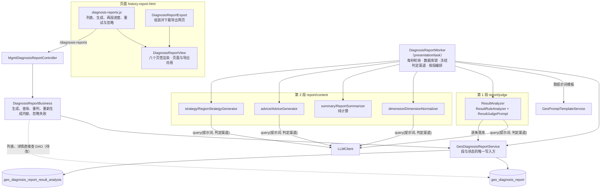
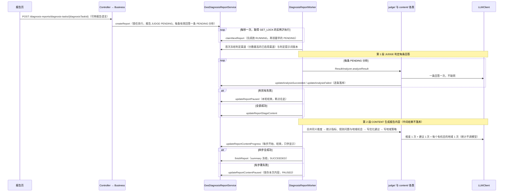
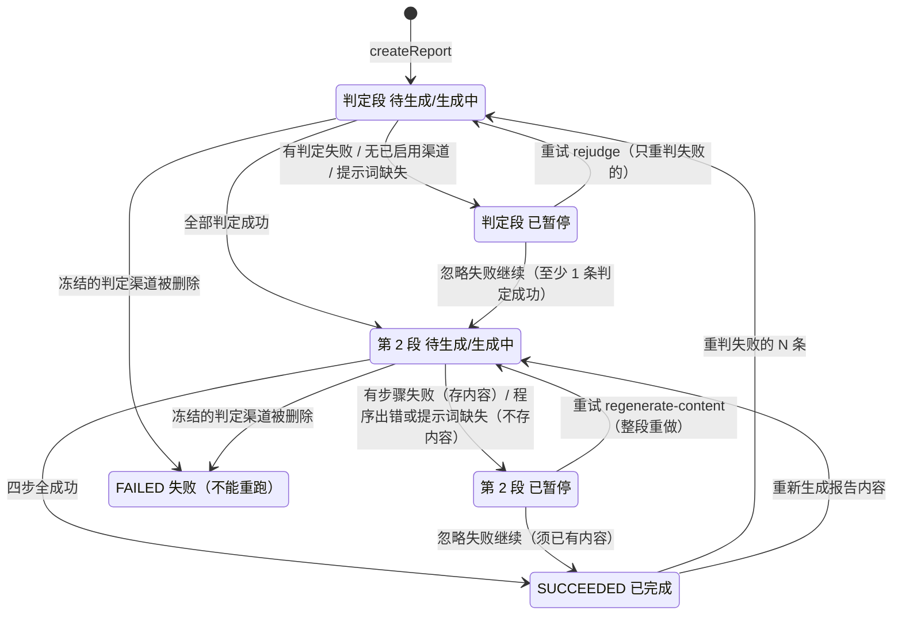

# 诊断报告

把一次已结束的诊断任务的全部有效回答（成功且未被截断）分两段加工成报告：第 1 段逐条调用模型判定，第 2 段汇成 ⓪–⑦ 八个页签（⓪ 诊断大盘是首页签）。任一段有失败就暂停，由用户选择重试或忽略失败继续。报告可导出为可离线打开的网页。

## 分层

## 一次报告怎么生成

段（`stage`）与状态（`status`）一起表示进度；页面「重试」在判定段调 `rejudge`，在第 2 段调 `regenerate-content`：

## 核心类

| 类 | 一句话 |
|---|---|
| `MgmtDiagnosisReportController` | `/diagnosis-reports` 下 6 个接口：生成、列表、详情、`rejudge`、`regenerate-content`、`skip-failures` |
| `DiagnosisReportBusiness` | 接口用例：转调报告服务改状态；列表与详情带判定进度、子步骤进度，只有已完成或停在第 2 段暂停时才返回 summary |
| `GeoDiagnosisReportService` | 创建、领取、冻结渠道与提示词版本、逐条落库、暂停、完成、失败、重新排队的前置校验；写库都带当前状态条件 |
| `DiagnosisReportWorker` | 轮询与数据库会话锁 `:diagnosis-report-worker`（开关 `diagnosis.reports.enabled`），按 stage 编排两段并决定暂停 |
| `DiagnosisReportContentProgress` | 第 2 段四个子步骤的状态与说明，写入 `content_progress`，同时拼暂停原因 |
| `ResultAnalyzer` | 一条回答：规则归类来源 → 判定模型 → 校验原文片段后落库；失败只记本条 |
| `DimensionNormalizer` / `ReportSummarizer` / `AdviceGenerator` / `RegionStrategyGenerator` | 第 2 段四个子步骤的入口，顺序见 `content/package-info.java` |
| 各 `*Prompt` | 模板 + 数据 → 提示词，校验模型输出；不访问数据库，模板由 Worker 取出后传入 |
| `DiagnosisReportStage` / `DiagnosisReportStatus` / `DiagnosisReportResultAnalysisStatus` | 段 `JUDGE`/`CONTENT`；报告 `PENDING`/`RUNNING`/`PAUSED`/`SUCCEEDED`/`FAILED`；单条 `PENDING`/`SUCCEEDED`/`FAILED` |

源码：[report 包](../../src/main/java/org/huangry/colorful/geo/domain/service/diagnosis/report/)、[DiagnosisReportWorker](../../src/main/java/org/huangry/colorful/geo/presentation/task/DiagnosisReportWorker.java)；已确认决策见 [诊断模块记忆](../../.claude/memory/modules/diagnosis.md)、[提示词管理记忆](../../.claude/memory/modules/prompt-template.md)。

## 八个页签的数据来源

规则计算都在 `content/summary/`，输入是第 1 段的判定结果与规则归类的来源，排行用合并后的维度名；只有标“模型”的部分由第 2 段调用模型书写。

| 页签 | summary 字段 ← 来源 |
|---|---|
| ⓪ 诊断大盘 | `dashboard` ← `ReportDashboardSummarizer`（规则：合计一份、每个模型一份）；趋势与「较上次」← 详情的 `dashboardTrend`，打开详情时由 `GeoDiagnosisReportService.listEarlierDashboardPoints` 现读同方案更早任务的大盘，不冻结 |
| ① 诊断概览 | `sample`（含 `offTargetBrandAnswers`、`offTargetComparisonAnswers`）、`models` ← `ReportOverviewSummarizer`（规则）；主要发现与前三条行动 ← `advice`（模型） |
| ② 可见度与推荐 | `models`（同上）；`strength`、`reservations`、`criteria`、`concerns` ← `ReportVisibilitySummarizer`（规则） |
| ③ 品牌认知 | `brand` ← `ReportBrandSummarizer`（规则，只看点名问题） |
| ④ 竞品对比 | `competitor` ← `ReportCompetitorSummarizer`（规则） |
| ⑤ 引用与内容 | `source` ← `ReportSourceSummarizer`（规则，判定失败的回答也参与） |
| ⑥ 优化建议 | `issues` ← `ReportIssueSummarizer`（规则阈值，编号 P1…）；`advice` ← `AdviceGenerator`（模型，只能引用问题编号） |
| ⑦ 地域报告 | `region` ← `ReportRegionSummarizer`（规则：宣传状态及计为正面、负面的回答清单、可见度、机会 R1-O1…）；各地域 `strategy` ← `RegionStrategyGenerator`（模型） |

## 新业务接入改哪里

| 情况 | 要改的 | 不用改 |
|---|---|---|
| 新增一个页签 | `content/summary/` 加汇总类，由 `ReportSummarizer.buildSummary` 放进 summary；`DiagnosisReportView.tabs` 加一项 | 导出、Worker、接口、表结构（summary 是 JSON） |
| 新增一段模型书写的内容 | `content/` 下建子包（生成器 + `*Prompt`）；`PromptTemplateKey` 加枚举并写初始模板；Worker 按顺序调用；`DiagnosisReportContentProgress.Step` 与页面 `contentStepLabels` 各加一步 | 第 1 段、状态枚举、表结构 |
| 改判定口径 | 只改措辞：提示词管理存新版；改输出字段：同步 `ResultJudgePrompt` 解析与下游汇总类 | Worker、状态流转（已判定成功的不重判） |
| 改规则阈值或指标 | 对应 `Report*Summarizer`（问题阈值在 `ReportIssueSummarizer`） | 第 1 段；旧报告点「重新生成报告内容」生效 |
| 新增或改一个指标 | 算法在对应 `Report*Summarizer`；页面上的一句话解释在 `diagnosis-report-view.js` 的 `metricHelps`（全报告共用一份），所在区块的 `sectionHelps.items` 加上它的键名 | 导出、其他页签里同一指标的解释（自动一致） |
| 改导出网页 | 一般只改页签渲染函数，导出自动跟随 | 后端 |

## 约束

- 只在两段之间设断点：第 1 段逐条落库、重跑只判失败的；第 2 段中间结果不存，失败整段重做；子步骤进度只用于显示。
- 失败就暂停、不自动重试；建议或策略没有一条有效条目也算失败。
- 重跑不换判定渠道，冻结渠道被删除才 FAILED；判定提示词按冻结版本，手动重判改用最新版。
- 同一任务同时最多一份报告在生成；同一库只有持有 `GET_LOCK` 的实例执行。
- 页签只用已读取的数据同步渲染、查看入口经 `context.entries` 生成，导出才能自动跟随；报告语言只影响模型书写的内容。
- 指标和区块的解释不常驻在页面上，收在标题旁的小问号里（`helpBubble`，原生展开元素，导出网页同样可用）；某份报告特有的情况（如有几条没计入）直接显示，不放进小问号（2026-11-26）。
- 问题分组以 `ReportAnswerFacts` 的判断为准：点名题除了方案里的标记（BRAND），还要求问题原文出现目标名称或别名（`DiagnosisQuestionTextRule.isTargetNamed`，与方案校验同一判断），问别的品牌的不算点名题；对比题只看标记，但问题里没有目标时，维度胜负由 `ReportCompetitorSummarizer` 逐条核对文字里有没有点到目标。只去掉算错的，并在页面写明条数（`sample.offTargetBrandAnswers`、`offTargetComparisonAnswers`、`competitor.excludedDimensionResults`），不悄悄删内容（2026-11-26）。

## 已知待改

- `DiagnosisReportWorker` 自己按段编排、直接注入领域依赖和 `LLMStrategyRouter`，按分层规范应由应用执行器组织（代码未迁移）。
- `DiagnosisReportBusiness` 直查 3 个 DAO；`ResultAnalyzer` 经报告服务落库；报告服务直连 DAO 并读 `ContentPublishRecordDao`。
- 维度数上千时合并同义维度可能超出单次输出上限（416 个实测通过）；`diagnosis-reports.js` 没有前端测试。

详见 [项目规范检查-2026-11-22](../20261115_area_diagnosis/项目规范检查-2026-11-22.md)。
