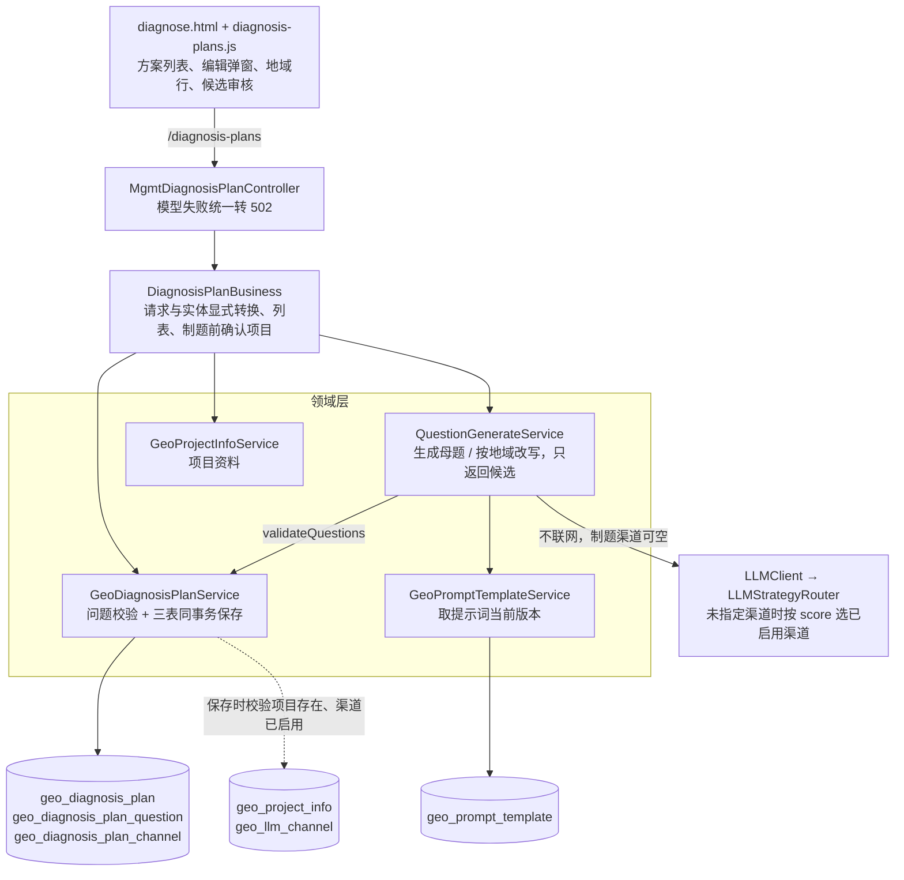
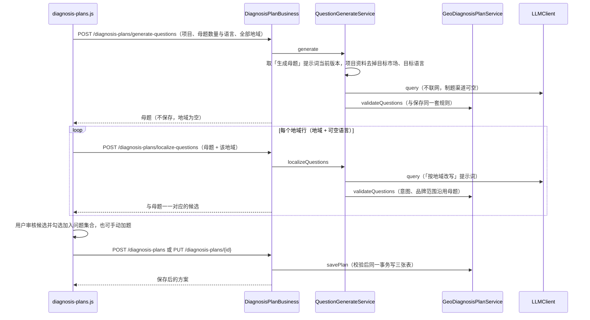

# 诊断方案

为项目保存一份可重复执行的诊断配置，包括问题集合、被测模型渠道和每题重复执行次数。问题可以手动添加，也可以先让模型生成一套母题，再按地域逐个改写成当地用户会问的问题，审核后加入。方案只保存配置，不调用被测模型；执行见 [诊断任务](诊断任务.md)。入口在「资产诊断 → 诊断方案」。

## 分层

## 一次制题怎么走

## 核心类

| 类 | 一句话 |
|---|---|
| `MgmtDiagnosisPlanController` | 6 个接口：列表、详情、创建、修改、生成母题、按地域改写；`LLMClientException` 转 502，不回传模型原文 |
| `DiagnosisPlanBusiness` | 请求与实体逐字段转换；制题前确认项目存在；列表批量取项目名 |
| `QuestionGenerateService` | 取提示词、填变量、调制题模型、严格解析 JSON 数组；只返回候选，不落库 |
| `GeoDiagnosisPlanService` | `validateQuestions`（生成、改写、保存、建任务共用）、`confirmQuestionRegion`、`savePlan` 三表事务 |
| `DiagnosisQuestion` | 问题的接口模型：正文、来源、意图、品牌范围、语言、地域（空 = 不分地域） |
| `PromptTemplateKey` | 制题用 `DIAGNOSIS_PLAN_QUESTION_GENERATE`、`DIAGNOSIS_PLAN_QUESTION_LOCALIZE` 两个提示词 |
| `diagnosis-plans.js` | 地域行、先生成母题再逐行改写、候选审核；候选超出 500 题剩余容量时提前拦截 |

源码：[application/diagnosis](../../src/main/java/org/huangry/colorful/geo/application/diagnosis/)、[GeoDiagnosisPlanService](../../src/main/java/org/huangry/colorful/geo/domain/service/diagnosis/GeoDiagnosisPlanService.java)、[QuestionGenerateService](../../src/main/java/org/huangry/colorful/geo/domain/service/QuestionGenerateService.java)。表结构见 [001_init.sql](../../src/main/resources/db/mysql/001_init.sql)，制题决策见 [诊断模块记忆](../../.claude/memory/modules/diagnosis.md)。

## 新业务接入改哪里

| 情况 | 要改的 | 不用改 |
|---|---|---|
| 新地域、新语言 | 不改代码：页面加一个地域行（地域是自由文本，最多 50 字；语言可空，空则由模型按地域选常用语言） | 枚举、表、提示词 |
| 换制题模型 | 页面「生成问题的模型」选渠道；留空时按 `score` 选已启用渠道 | 被测渠道、代码 |
| 调整制题话术 | 在「基础配置 → 提示词管理」保存新版本，下次调用生效；输出仍须是解析要求的 JSON 数组和字段 | 代码 |
| 加意图或品牌范围取值 | `DiagnosisQuestion` 枚举、`validateQuestions` 白名单、生成母题提示词里的取值说明（当前版本和 `001_init.sql` 初始模板）、`diagnosis-plans.js` / `diagnosis-tasks.js` / `diagnosis-report-view.js` 显示名；品牌范围还要看报告统计口径 `ReportAnswerFacts` | 表结构（VARCHAR）、改写流程（沿用母题） |
| 加题目来源（如导入） | `DiagnosisQuestion.Source`、`validateQuestions` 白名单、新的候选产出入口（参照 generate / localize：Business → 领域服务 → 返回候选不落库）、页面显示名 | 保存接口、方案表、任务冻结 |
| 问题加字段 | 表列 + 实体 + `DiagnosisQuestion` + Business 的 `toEntity` / `toQuestion` + `DiagnosisTaskSnapshots.buildQuestionSnapshot`（参考 `region` 的接入方式） | — |

## 约束

- 生成和改写只返回候选，不落库。母题只用于改写和审核对照，不保存。勾选的候选随「保存方案」整体提交：三张表在同一事务里写入，修改时先锁住方案，再整体替换问题和渠道。
- 地域必选，且只看本次输入。生成母题至少要有一个地域，母题必须在这些地域都成立；项目的目标市场、目标语言只在页面上作参考，不发给制题模型。改写时意图、品牌范围逐题沿用母题，模型只改正文和语言；任一条不合规则整批失败（502）。只要有一个地域失败，本次生成就作废，页面已有问题和候选保留。手动添加的题可以不分地域。
- 同一套校验 `validateQuestions` 用在生成、改写、保存和创建任务四处：每个方案 1～500 题；文本去重（NFKC、大小写、空白统一后比较）；非品牌题不能含项目名称或别名。每次生成或改写 1～100 题。
- 制题渠道与被测渠道相互独立：制题可以不选渠道，且不联网；被测渠道必须显式选择 1～20 个，保存时必须已启用。重复执行次数为 1～10。
- 提示词以库表为唯一来源：两个制题提示词每次调用都取当前版本；未配置时返回 404，不调用模型。

## 已知待改

- `QuestionGenerateService` 放在 `domain/service/` 根目录，没有按业务分包；它直接调用 `GeoDiagnosisPlanService`、`GeoPromptTemplateService`，属于领域 Service 互调，应改由 Business 分别调用。
- `GeoDiagnosisPlanService` 继承 `ServiceImpl`、直接使用 DAO，还跨模块读取 `GeoProjectInfoDao`、`GeoLlmChannelDao`。
- `DiagnosisPlanBusiness` 自己拼 `LambdaQueryWrapper` 查询列表，`PlanPageItem` 写在类内部，Business 与领域服务之间直接传数据库实体。
- `generate` 用 `catch (Exception)` 包装解析失败，可以收窄（`localizeQuestions` 已经收窄）。
