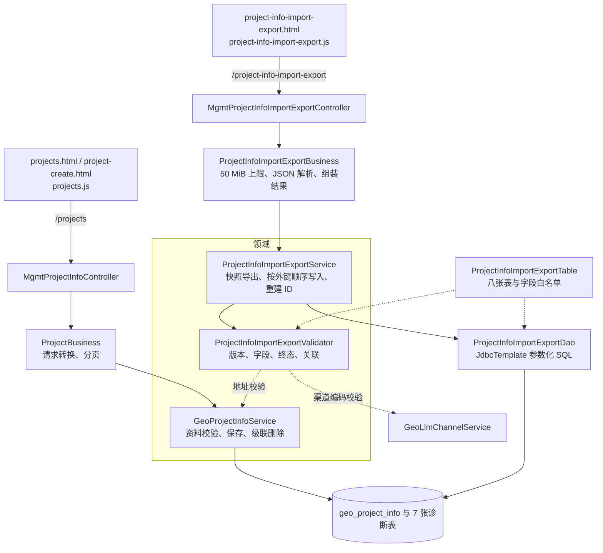
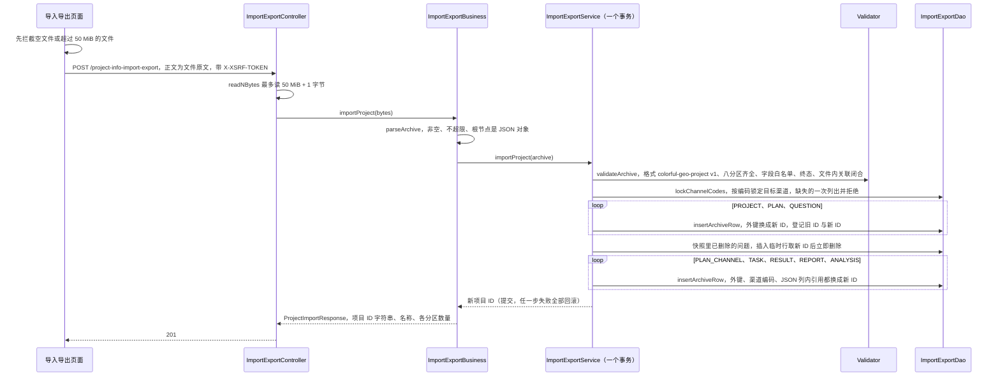

# 项目档案与导入导出

维护项目（品牌）的基础档案：新建、分页查询、整体删除，**目前没有修改入口**。另可把一个项目连同全部诊断历史导出为 JSON 文件，到另一个环境校验后导入为新项目。

## 分层

## 一次导入怎么走

导出走反方向：`REPEATABLE_READ` 只读事务读取八张表，渠道 ID 换成渠道编码，清空任务 `request_id`，再用同一个校验器检查后下载。

## 核心类

| 类 | 一句话 |
|---|---|
| `MgmtProjectInfoController` | `POST /projects` 新建（201）、`GET /projects` 分页（`keyword`、`page`、`size` 默认 20）、`DELETE /projects/{id}`（204） |
| `ProjectBusiness` | 请求字段显式转实体，用 `PageQuery` 分页，实体转 `ProjectInfoResponse` |
| `GeoProjectInfoService` | 必填与长度校验、官网必须是 HTTP(S)、列表最多 50 项；删除时锁项目、方案、任务后一个事务删 8 张表 |
| `MgmtProjectInfoImportExportController` | `GET /project-info-import-export/{projectId}` 下载（`no-store`）、`POST` 导入（201）；数据库约束不满足 400，数据库访问失败 500 |
| `ProjectInfoImportExportBusiness` | 文件边界：`MAX_FILE_BYTES` 50 MiB、JSON 解析、导入结果组装 |
| `ProjectInfoImportExportService` | 导出快照与渠道编码转换；导入时校验、锁渠道、按顺序插入、重建全部 ID |
| `ProjectInfoImportExportValidator` | 导出后、导入前各调一次；任何一项不合格，整份文件拒绝 |
| `ProjectInfoImportExportTable` | 分区名、表名、字段白名单；`JSON_COLUMNS` 为 JSON 列，`OPTIONAL_COLUMNS` 为旧文件可缺的后加列 |
| `ProjectInfoImportExportDao` | 表名、列名只取自白名单，值全部参数绑定；渠道表只读 ID 和编码 |

八个分区按外键顺序为：`project`、`plans`、`questions`、`planChannels`、`tasks`、`results`、`reports`、`analyses`，对应 `geo_project_info`、`geo_diagnosis_plan`、`geo_diagnosis_plan_question`、`geo_diagnosis_plan_channel`、`geo_diagnosis_task`、`geo_diagnosis_task_result`、`geo_diagnosis_report`、`geo_diagnosis_report_result_analysis`。

源码：[应用层](../../src/main/java/org/huangry/colorful/geo/application/project/)、[领域层](../../src/main/java/org/huangry/colorful/geo/domain/service/project/)、[表白名单](../../src/main/java/org/huangry/colorful/geo/infrastructure/common/enums/ProjectInfoImportExportTable.java)。

## 新业务接入改哪里

| 情况 | 要改的 | 不用改 |
|---|---|---|
| 项目新增字段 | 库表（`001_init.sql` 与迁移脚本）、`GeoProjectInfoEntity`、`CreateProjectRequest` 与 `ProjectInfoResponse`、`ProjectBusiness` 两处显式赋值、`GeoProjectInfoService.validateProject`、`project-create.html` 表单与 `projects.js` 详情标签；导入导出在 `PROJECT` 字段列表追加，JSON 列加入 `JSON_COLUMNS`，旧文件没有的列加入 `OPTIONAL_COLUMNS`；列表型字段还要改 `projects.js` 的拆行字段和校验器 `validateProjectColumns` | Controller、`ProjectInfoImportExportDao`、导入导出主流程 |
| 导入导出新增一张表 | `ProjectInfoImportExportTable` 按外键顺序加枚举值；`ProjectInfoImportExportDao.listProjectRows` 加归属条件；`ProjectInfoImportExportService` 的 `FOREIGN_KEYS` 和 `importProject` 里两组显式插入顺序；校验器 `validateRelations`，有状态列时加 `TERMINAL_STATUSES`；页面导入结果的 `labels`；`GeoProjectInfoService.deleteProject` 同步删除，保持与导出范围一致。旧文件缺少新分区时会被拒绝，是升版本号还是允许缺省：待确认 | `ProjectInfoImportExportBusiness`（数量按枚举自动统计）、Controller |

## 约束

- 导入总是新建项目副本，不覆盖已有项目；全部 ID 重建，文件里的 ID 用十进制字符串；同一文件重复导入会再建一份，请求不自动重试。
- 表名和字段只取自 `ProjectInfoImportExportTable` 白名单；文件里出现未声明字段、原始渠道 ID 或认证字段，整份拒绝。
- 渠道只按编码精确匹配目标环境已有的渠道，不自动新建；渠道连接配置、密钥、内容优化与发布记录都不导出。
- 有未结束的任务、诊断结果或报告时拒绝导出（报告只允许 `SUCCEEDED`、`PAUSED`、`FAILED`）；导入的历史记录不会被后台继续执行。
- 删除项目会连带删除全部诊断方案、任务、诊断结果、报告和回答分析，执行中的也删，无法恢复；模型渠道、内容优化与发布记录保留。

## 已知待改

- `GeoProjectInfoService` 继承 `ServiceImpl`，并直接注入 7 个诊断 DAO 做级联删除，属于领域 Service 跨模块读写表。
- `ProjectInfoImportExportService` 直接调用 `ProjectInfoImportExportDao`；`ProjectInfoImportExportValidator`（`@Service`）调用 `GeoProjectInfoService`、`GeoLlmChannelService`，属于领域 Service 互相调用。
- `ProjectBusiness` 与 `GeoProjectInfoService` 之间直接传数据库实体 `GeoProjectInfoEntity`，还没有领域模型。

以上见 [项目规范检查](../20261115_area_diagnosis/项目规范检查-2026-11-22.md) 第 4、5 节。
